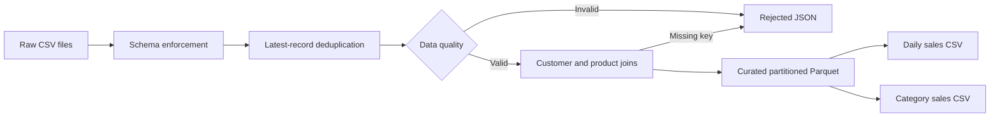

# PySpark Retail Analytics

A small, portfolio-ready data engineering project that turns raw retail CSV files into clean,
query-friendly datasets and sales reports.

The project is intentionally compact: it is large enough to demonstrate practical PySpark
skills, but small enough to run locally and explain clearly in an interview.

## What it demonstrates

- Explicit Spark schemas instead of automatic type inference
- CDC-style deduplication using a window function and `updated_at`
- Data-quality rules with rejected-record quarantine
- Customer and product dimension joins
- Decimal-safe revenue calculations
- Daily and category-level aggregations
- Partitioned Parquet output for analytical workloads
- Unit and end-to-end tests with `pytest`
- Automated linting and tests with GitHub Actions

## Pipeline



## Quick start

Prerequisites:

- Python 3.10 through 3.13
- Java 17 or Java 21

On macOS, select Java 17 if multiple Java versions are installed:

```bash
export JAVA_HOME=$(/usr/libexec/java_home -v 17)
```

Create an environment and install the project:

```bash
python3.12 -m venv .venv
source .venv/bin/activate
python -m pip install --upgrade pip
python -m pip install -e ".[dev]"
```

Run the demo:

```bash
retail-analytics --input-dir data/raw --output-dir output
```

Run the checks:

```bash
ruff check .
pytest
```

## Generated output

```text
output/
├── curated/
│   └── sales/                 # Parquet, partitioned by order_date
├── rejected/
│   └── orders/                # Invalid and missing-dimension records as JSON
├── reports/
│   ├── category_sales/        # Ranked category KPIs as CSV
│   └── daily_sales/           # Daily KPIs as CSV
└── run_summary.json           # Observable pipeline row counts
```

Rerunning the job is deterministic and overwrites only its generated output directories.

## Data-quality behavior

The sample data deliberately includes:

- A duplicate order update, where only the latest version is retained
- An order with zero quantity
- An order with a discount above 100%
- An unknown customer key
- An unknown product key

Bad records are preserved with readable rejection reasons instead of being silently dropped.

## Project structure

```text
.
├── .github/workflows/ci.yml
├── data/raw/
├── src/retail_analytics/
│   ├── job.py
│   ├── schemas.py
│   └── transforms.py
├── tests/
├── LICENSE
├── pyproject.toml
└── README.md
```

## Resume-ready description

Use these points only after running the project and understanding the code:

- Built a PySpark retail ETL pipeline with explicit schemas, window-based deduplication,
  dimension joins, and partitioned Parquet outputs.
- Implemented data-quality validation and rejected-record quarantine for invalid measures and
  missing dimension keys.
- Added automated unit and end-to-end tests plus GitHub Actions CI for repeatable validation.

## Interview talking points

- Why financial values use `DecimalType` instead of floating-point types
- Why a business key plus `updated_at` is used for deduplication
- Why rejected data is retained for investigation
- Why Parquet is used for curated data and CSV only for small human-readable reports
- How the local pipeline could later run on Databricks, Amazon EMR, or another Spark platform

## Ideas for extending the project

- Add incremental processing with Delta Lake or Apache Iceberg
- Add Great Expectations or Deequ checks
- Publish aggregate tables to PostgreSQL
- Orchestrate daily runs with Airflow
- Add a dashboard in Power BI, Tableau, or Streamlit

## Publish to GitHub

Before publishing, add your name to `LICENSE` and update the repository description if you
extend the project. Then run:

```bash
git add .
git commit -m "Build PySpark retail analytics pipeline"
git remote add origin https://github.com/YOUR_USERNAME/pyspark-retail-analytics.git
git push -u origin main
```

## License

MIT
